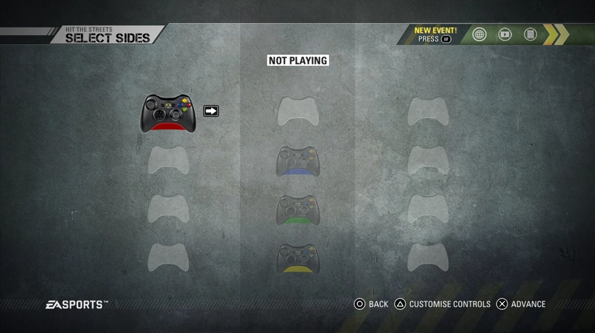
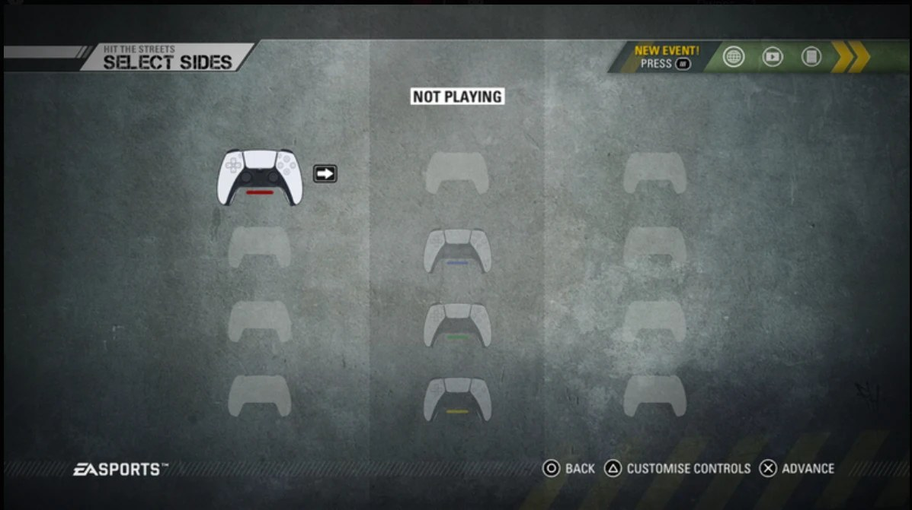
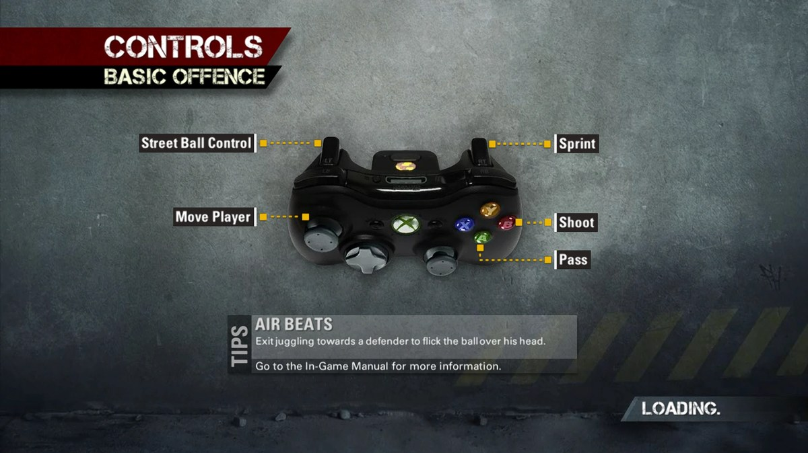
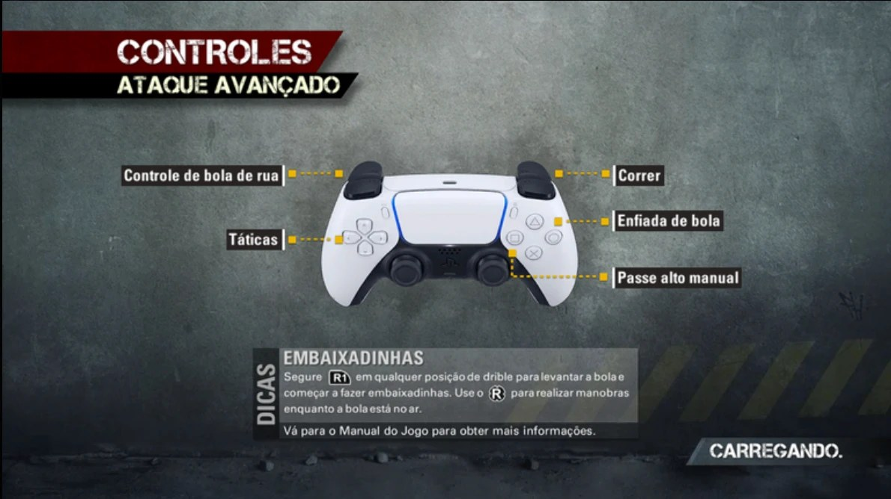

# ReStreetAssetScan

Read-only explorer for FIFA Street's EA BIG archives (`data0.big` … `data7.big` and the `.big` files under `data/`). It opens nested BIGs, decodes `chunklzx` (Xbox LZX), `chunkzip` (deflate) and RefPack entries, and converts DDS and Xbox 360 XPR2 textures to PNG. It never writes to the game folder.

```bash
dotnet build -c Release Tools/ReStreetAssetScan
```

```bash
ReStreetAssetScan list    <game folder> [--filter regex]
ReStreetAssetScan extract <game folder> <output> [--filter regex] [--png]
ReStreetAssetScan buttons <game folder> <output>
```

`<game folder>` is the ReStreet `Game` folder (or the old `GameData`). Entry paths use `!` between archive levels, for example `data0.big!data/ui/external/ion_sports07/platform/proxy/art/a.big!2`.

`buttons` saves every controller texture as PNG and writes `REPORT.md` with:

- **Button prompts**: `data/ui/external/ion_sports07/platform/proxy/art/*.big` in `data0.big` (A, B, X, Y, LB, RB, LT, RT, LS/RS directions, D-pad, START, BACK, the Guide button) and `controllers.big` / `tricks.big` in `data1.big`. Each menu imports these by path, so one texture changes every screen that shows that button.
- **Skill-move pictures**: `data/ui/imgassets/tricks/xenon/` and `.../tricks/ps3/`. The game ships both sets; the PS3 one already uses R, R1, L1 and R3.
- **Controller pictures**: `controller_xbox360.big` and `controller_ps3.big`.
- Which screens use each prompt.

Keep the output out of Git: it is game data (`private/` is ignored).

## DualSense button art

| Before | After |
|---|---|
|  |  |
|  |  |

```bash
ReStreetAssetScan dualsense preview <game folder> <output> --controller ps5
ReStreetAssetScan dualsense apply   <game folder> --controller ps5
ReStreetAssetScan dualsense revert  <game folder>
ReStreetAssetScan dualsense status  <game folder>
```

`--controller` says which PlayStation pad the art is for and is required by `preview` and `apply`. It is stored as one byte (`ps5` = `0x05`, the DualSense, the only art so far; `ps4` = `0x04` is reserved for the DualShock 4 and refused until its art exists). `apply` writes it into the backups (`RSD2` + that byte) and `status` reads it back.

Close the game first. `preview` writes before/after PNGs and changes nothing. `apply` patches `data0.big`, `data1.big` and their `.bh` indexes:

- **Button prompts** (35 textures): the game's own texture keeps its outline and shading; the Xbox symbol inside the black face is replaced with a glyph from `DualSense/`: A ✕, B ○, X □, Y △, LB/RB L1/R1, LT/RT L2/R2, LS/RS L/R, L3/R3, START Options, BACK Create, Guide PS.
- **Skill-move list**: the `tricks/xenon/` pictures point at the PS3 set the game already ships.
- **In-match skill hints** (`proxy/art/tricks.big`): rebuilt from the PS3 pictures, keeping the HUD's brighter arrows.
- **Select Sides controller**: a white DualSense drawn by `make_glyphs.py` replaces the Xbox 360 pad in both controller sets in `data1.big`:
  - `data/ui/game/components/fifasideselector.big`, used by the offline Select Sides screen: texture 33 (pad), 30 (the strip the game tints with each player's colour) and 8 (the empty-slot silhouette) become `sideselector*.png`.
  - `proxy/art/controllers.big`: texture 5 (pad) and 2 (strip) become `controller*.png`.

  The strip sits along the bottom of the pad's black centre, where the game draws it.

Changed entries are appended to the archive, as the installer's credit patch does. The original directory, index and length are saved to `<archive>.dualsense-backup` first; `revert` restores the files byte for byte. Revert before running a ReStreet update or repair, and apply again afterwards.

### Your own controller picture

1. If the picture's "transparent" background is a checkerboard saved into the pixels, cut it out:
   `python DualSense/cutout.py <picture.png> private/dualsense-cutout.png`
2. Build the Select Sides textures from it (front view, cropped tight; strip style `pill`, `accents` or `none`):
   `python DualSense/pad_from_image.py private/dualsense-cutout.png private/dualsense-art pill`
3. Patch with that folder; files missing from it come from `DualSense/`:
   `ReStreetAssetScan dualsense apply <game folder> --controller ps5 --art private/dualsense-art`

Keep pictures you did not make yourself, and what is built from them, in `private/` (not in Git).

### Controls screens (call-out lines)

The loading screens, the Game Manual and the controller settings are switched to their PlayStation layout, whose lines point at the game's DualShock 3 photo. To show a DualSense there instead, give a picture **shot from above like that photo** (L2/R2 visible behind L1/R1), cut out, plus its button centres:

`python DualSense/controls_from_image.py private/dualsense-controles-cutout.png private/dualsense-controles-points.json private/dualsense-art`

It fits the picture on the line ends (`controls.png`, 512×256) and reuses that placement ×1.45 for the settings copy (`controls_large.png`, 1024×512, whose visible area clips the grip tips). Without these two files the screens keep the DualShock 3 photo.

The glyphs are original art. Edit the PNGs or regenerate them with `python DualSense/make_glyphs.py`; the patcher scales each one into the button face.
